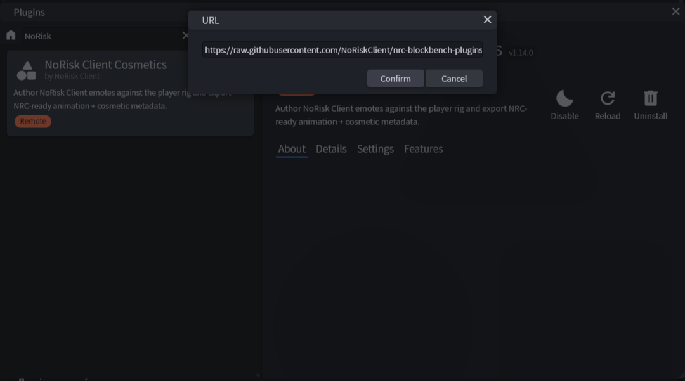
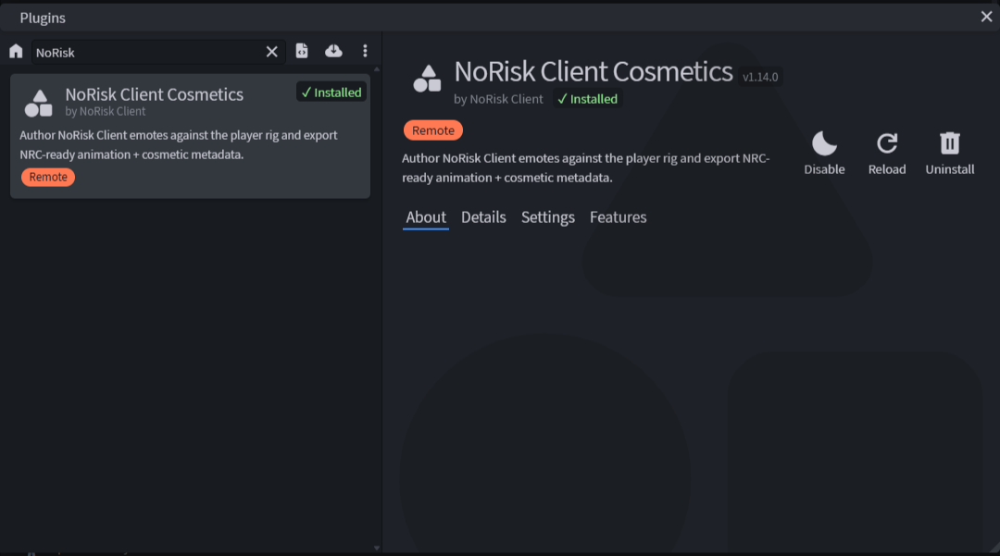
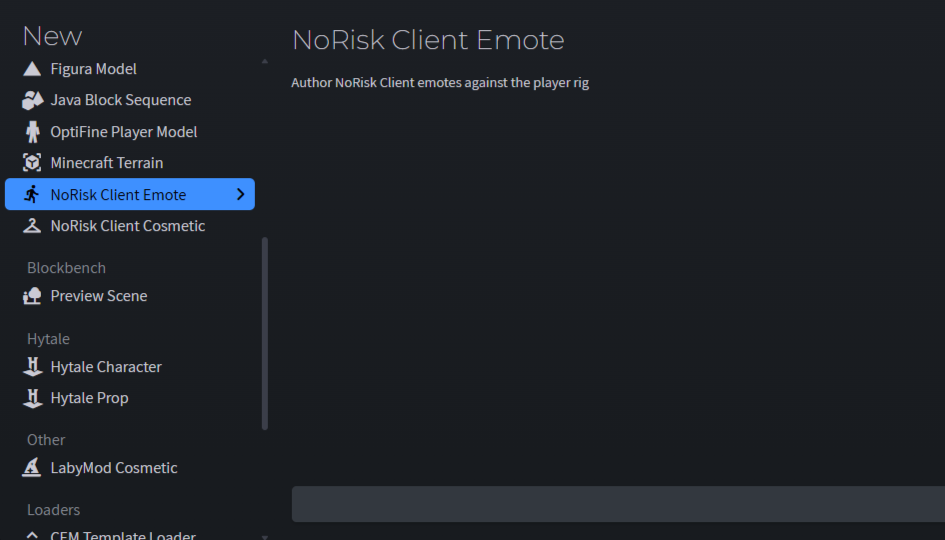
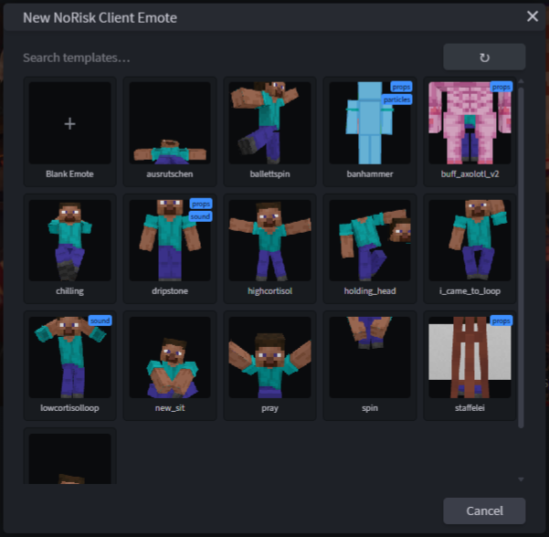
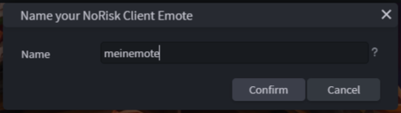
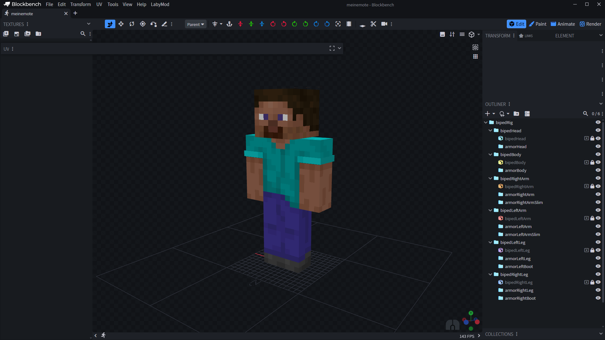
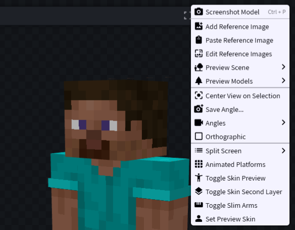

# 1. Grundlagen

← [Home](Home) · **1 / 15** · [Aufbau →](02-Aufbau)

---

Bevor du loslegst, brauchst du **Blockbench** und unser eigenes Plugin **NoRisk Client Cosmetics**. Das Plugin bringt das Spieler-Rig, die Emote-Einstellungen und den Export mit — ein extra Template oder GeckoLib brauchst du nicht mehr.

> 🚫 **Keine KI:** Cosmetics und Emotes mit KI zu erstellen ist **verboten** — egal ob Modell, Textur, Animation oder Sound. Wir dulden das nicht und legen Wert darauf, dass diese Arbeit **Handarbeit** bleibt. → [Home](Home#-keine-ki)

## Blockbench

Blockbench ist ein kostenloses Open-Source 3D-Modeling-Programm, das unter anderem auch von Minecraft selbst benutzt wird. Nimm die **Desktop-Version** — in der WebApp kann das Plugin keine Ordner schreiben, Texturen und Sounds werden dort nicht exportiert.

🔗 https://www.blockbench.net/

> ℹ️ Das Plugin braucht mindestens **Blockbench 4.11**.

## NRC-Plugin installieren

1. Öffne Blockbench
2. Oben in der Menüleiste auf **File → Plugins**
3. Oben rechts im Plugin-Fenster auf **Load Plugin from URL** (Wolken-Symbol)
4. Diesen Link einfügen und bestätigen:

```
https://raw.githubusercontent.com/NoRiskClient/nrc-blockbench-plugins/master/plugins/nrc_cosmetics/nrc_cosmetics.js
```

5. Fragt Blockbench nach Berechtigungen (Dateisystem, Netzwerk): **erlauben** — das Plugin braucht sie für Export, Import, Vorlagen und Skin-Vorschau.



Danach taucht **NoRisk Client Cosmetics** in der Liste der installierten Plugins auf.



> 💡 **Updates:** Ein über URL geladenes Plugin holt sich Blockbench beim Start neu. Willst du sichergehen, dass du die neueste Version hast: Blockbench neu starten.

## Neues Projekt

Über **File → New** (oder den Startbildschirm) gibt es jetzt zwei neue Formate:

| Format | Wofür |
|--------|-------|
| **NoRisk Client Emote** | Emotes — mit Vorlagen-Auswahl |
| **NoRisk Client Cosmetic** | Cosmetics — startet direkt mit der Animation `nrc.idle` |



### Vorlagen für Emotes

Bei **NoRisk Client Emote** öffnet sich eine Auswahl: **Blank Emote** für einen leeren Start oder eine der Vorlagen. Die Vorlagen sind die Emotes aus unserem [Designer-Ordner](https://github.com/NoRiskClient/nrc-designer-docs/releases/latest/download/nrc-cosmetics.zip) und werden mit **Live-Vorschau** angezeigt. Mit **↻** lädst du die neueste Version herunter.

Danach gibst du deinem Emote einen Namen (nur Kleinbuchstaben, Ziffern, `_`, `-`, `.`).





### Das Spieler-Rig

Jedes Projekt startet mit dem Spieler-Rig: `bipedRig` mit Kopf, Körper, Armen, Beinen und allen `armor`-Knochen. Was die Knochen bedeuten, steht in [2. Aufbau](02-Aufbau).

- Die Cubes des Rigs sind nur zur **Orientierung** — exportiert werden **nur deine eigenen** Cubes.
- **Edit → Protect Player Rig** sperrt die Rig-Cubes, damit du sie nicht aus Versehen verschiebst.



### Vorschau mit deinem Skin

Rechtsklick in die Vorschau:

| Eintrag | Was passiert |
|---------|--------------|
| **Set Preview Skin** | Minecraft-Namen eingeben oder PNG wählen → das Rig trägt diesen Skin |
| **Toggle Skin Preview** | Skin an/aus (aus = farbige Marker-Cubes) |
| **Toggle Skin Second Layer** | Zweite Skin-Ebene (Hut, Jacke, Ärmel, Hose) an/aus |
| **Toggle Slim Arms** | Zwischen breitem (Steve) und schmalem (Alex) Modell wechseln |



---

## Altes Template (nicht mehr nötig)

Früher lief alles über das **NRC Default Template** + **GeckoLib-Plugin**. Das brauchst du nicht mehr. Fertige Emote-/Cosmetic-Ordner (mit `.animation.json`, `.geo.json`, `.png` …) kannst du über **File → Import → Import NoRisk Client Emote / Cosmetic** ins neue Format holen → [15. Blockbench-Plugin](15-Blockbench-Plugin#import).

Das alte Template liegt aus Kompatibilitätsgründen weiter im [Release](https://github.com/NoRiskClient/nrc-designer-docs/releases/latest/download/nrc_default_emote_model.bbmodel).

---

← [Home](Home) · **1 / 15** · [Aufbau →](02-Aufbau)
