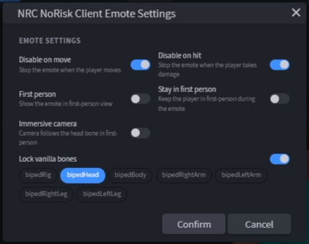

# 5. Animation

← [Texture](04-Texture) · **5 / 15** · [Keyframes →](06-Keyframes)

---

Bei der Animation beginnt der Spaß erst so richtig.

## Animation erstellen

Das Plugin legt die erste Animation schon für dich an:

- **Emote:** die Animation heißt wie dein Emote (z.B. `meinerstemote`).
- **Cosmetic:** die Animation heißt `nrc.idle` und steht auf **Loop**.

Weitere Animationen legst du im **Animate**-Modus links über **+** an.

> 💡 Emote umbenennen? **File → Rename NoRisk Client Emote** ändert Projekt, Animation und alle Sound-IDs auf einmal.

## Emote-Einstellungen

Bei Emotes stellst du über **Animation → Edit NoRisk Client Emote Settings** ein, wie sich das Emote ingame verhält — z.B. ob es beim Laufen abbricht oder in der Ego-Perspektive sichtbar ist. Die gleichen Schalter findest du nochmal im [Export-Dialog](10-Export). Was jeder Schalter macht: [14. Referenz](14-Referenz#extra-einstellungen-in-der-animationjson-emotes).

## Animationsnamen für Cosmetics

`nrc.idle` ist **Pflicht**. Zusätzlich kannst du Animationen für bestimmte Situationen anlegen — der Client spielt sie automatisch ab, sobald der Spieler das Passende tut:

| Animation | Wird gespielt, wenn der Spieler … |
|-----------|-----------------------------------|
| `nrc.crawling` | kriecht |
| `nrc.swimmidle` | im Wasser ist, aber nicht schwimmt |
| `nrc.swimming` | schwimmt |
| `nrc.flying` | fliegt (z.B. Elytra) |
| `nrc.jumping` | nach oben springt |
| `nrc.falling` | fällt |
| `nrc.afk` | AFK ist |
| `nrc.sitting` | sitzt |
| `nrc.sneaking` | schleicht |
| `nrc.running` | sprintet |
| `nrc.walking` | läuft |
| `nrc.quirk_1` … `nrc.quirk_4` | still steht — zufällige Extra-Animation zwischendurch |
| `nrc.idle` | nichts von alledem tut |
| `nrc.shop` | im Shop als Vorschau gezeigt wird (optional, sonst `nrc.idle`) |

Die Liste (ohne `nrc.shop`) ist gleichzeitig die **Reihenfolge**: trifft mehreres zu, gewinnt das obere. Fehlt eine Animation, wird sie einfach übersprungen — am Ende landet der Client immer bei `nrc.idle`.

> 💡 Wie oft die Quirks kommen, stellst du in der `.norisk.json` unter `animationSettings` ein → [Referenz](14-Referenz#quirks-animationsettings).

## Loop-Modi

Die drei Loop-Modi haben unterschiedliche Zwecke:

| Modus | Wann benutzen |
|-------|---------------|
| **Play Once** | Emote mit klar geschlossenem Ende |
| **Loop** | Animation soll sich unendlich wiederholen |
| **Hold On Last Frame** | End-Frame soll gehalten werden — oder am Ende läuft [Molang](07-Molang) |

## Bones in die Timeline

Klick einfach auf einen Bone — entweder im **Outliner** oder in der **Live-Preview** — und er wird unten in der **Timeline** angezeigt.

## Animationslänge

Die **blaue Klammer** schreibt das Ende der Animation vor. Du kannst sie demnach **je nach Lust und Laune verschieben**, um die Animation zu verlängern oder zu kürzen.

---

← [Texture](04-Texture) · **5 / 15** · [Keyframes →](06-Keyframes)
