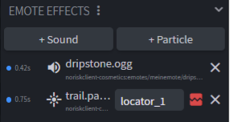

# 8. Particle

← [Molang](07-Molang) · **8 / 15** · [Sound →](09-Sound)

---

Für Particle nutzen wir **Snowstorm**. Das Tool kannst du entweder als **WebApp** oder als **VS-Code Extension** benutzen.

🔗 https://snowstorm.app/

> 💾 Speichere die fertigen Particle **immer zusammen mit ihrer Textur** ab. Die Datei sollte auf **`.particle.json`** enden, z.B. `trail.particle.json`.

---

## Particle ins Emote/Cosmetic einbinden

Particles und Sounds verwaltest du im Panel **Emote Effects** — es erscheint rechts, sobald du im **Animate**-Modus bist.

### 1. Particle hinzufügen

1. Playhead in der Timeline an die Stelle schieben, wo der Particle starten soll
2. Im Panel **Emote Effects** auf **+ Particle**
3. Deine `.particle.json` auswählen

### 2. Textur verknüpfen

Neben dem Particle siehst du ein Bild-Symbol:

- 🖼️ **normal** → Textur ist verknüpft
- 🔴 **rot durchgestrichen** → keine Textur gefunden, Blockbench zeigt einen Platzhalter. Klick drauf und wähle die PNG aus.

### 3. Locator wählen

Particles brauchen einen **Locator** — sonst erscheinen sie ingame am falschen Ort (oder am falschen Spieler).

Im Dropdown neben dem Particle:

- einen bestehenden Locator auswählen, **oder**
- **+ new locator on selected bone** → legt direkt einen Locator am gerade ausgewählten Knochen an

> 💡 Den Locator kannst du danach im **Edit**-Modus im Outliner verschieben, z.B. an die Hand.

### 4. Testen

Leertaste — die Particle werden in der Vorschau mit abgespielt.

### Status-Punkte

| Punkt | Bedeutung |
|-------|-----------|
| 🟢 farbig | Datei gefunden, alles gut |
| ⚪ grau | Keine Datei verknüpft oder Datei nicht mehr da |
| 🔴 rot | Keyframe hat noch gar keinen Effekt |

> ✅ Beim [Export](10-Export) kopiert das Plugin alle Particle-Dateien und Texturen automatisch mit in den Ordner und setzt die richtigen IDs. Du musst nichts von Hand umbenennen.

---

← [Molang](07-Molang) · **8 / 15** · [Sound →](09-Sound)
