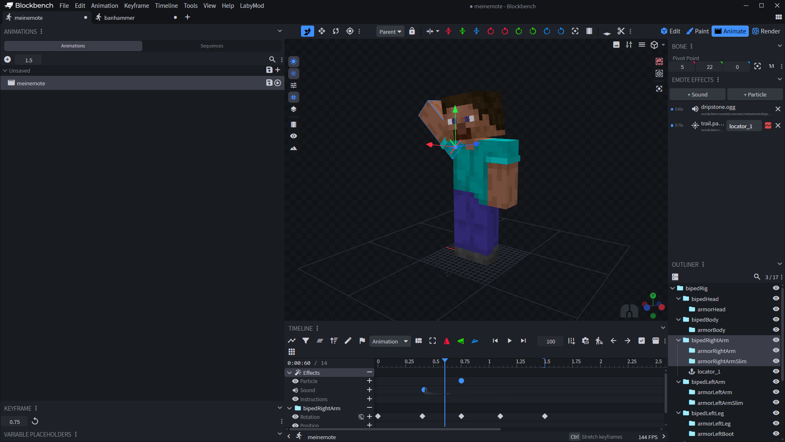

# 9. Sound

← [Particle](08-Particle) · **9 / 15** · [Export →](10-Export)

---

> ⚖️ **Rechtliches:** Für Sounds brauchst du die **Nutzungsrechte**. Verwende keine fremden, geschützten Audiodateien.

## Sound-Format

Sounds müssen folgendes Format haben:

- **Mono-Spur** (keine Stereo!)
- Dateiformat: **`.ogg`**

Beides kannst du einfach in **Audacity** einstellen.

🔗 https://www.audacityteam.org/

## Sound vorbereiten in Audacity

## Sound im Modell einbinden

1. In den **Animate**-Modus wechseln
2. Playhead an die Stelle schieben, wo der Sound starten soll
3. Im Panel **Emote Effects** auf **+ Sound**
4. Deine `.ogg` auswählen — der Sound erscheint in der Liste und in der Timeline

Die Sound-ID setzt das Plugin automatisch (`noriskclient-cosmetics:emotes/<emote>/<sound>`). Benennst du das Emote später um (**File → Rename NoRisk Client Emote**), werden die IDs mit angepasst.

## Vanilla-Sounds

Du kannst auch Sounds aus Minecraft selbst benutzen. Trag dafür im Keyframe als **Effect** den Namen des Sound-Events ein, z.B. `entity.cat.ambient`.

- Hast du Minecraft installiert, findet das Plugin den Sound in deinen lokalen Minecraft-Dateien. Mit ▶️ neben dem Eintrag hörst du ihn direkt in Blockbench.
- Vanilla-Sounds werden **nicht** mitexportiert — der Client hat sie ja schon.

---

← [Particle](08-Particle) · **9 / 15** · [Export →](10-Export)
