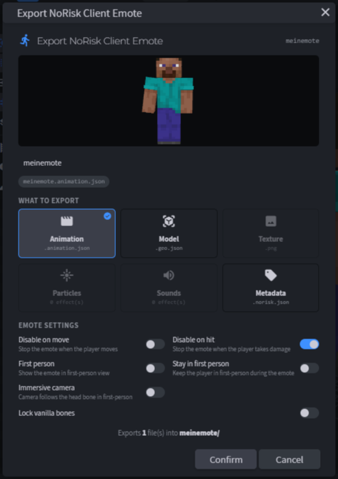
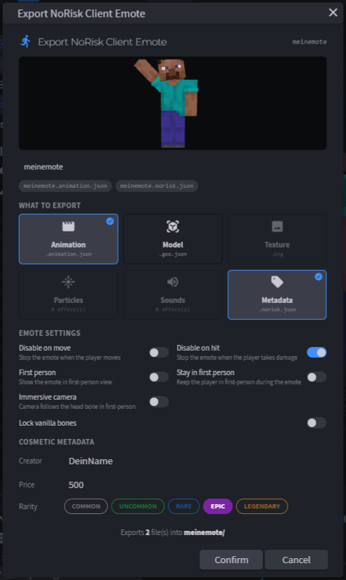

# 10. Export

← [Sound](09-Sound) · **10 / 15** · [Test-Setup →](11-Test-Setup)

---

Exportiert wird über unser Plugin — ein Klick, alle Files richtig benannt in einem Ordner.

**File → Export → Export NoRisk Client Emote** bzw. **Export NoRisk Client Cosmetic**



## Der Export-Dialog

### Name

Oben läuft eine **Live-Vorschau** deiner Animation, darunter trägst du den Namen ein. Daraus wird der **Dateiname** — automatisch klein geschrieben, Leer- und Sonderzeichen werden ersetzt. Direkt darunter siehst du als Chips, welche Dateien gleich rausgeschrieben werden.

### Was exportiert wird

Klick die Karten an oder aus:

| Karte | Datei | Standardmäßig an, wenn … |
|-------|-------|--------------------------|
| **Animation** | `<name>.animation.json` | es Animationen gibt |
| **Model** | `<name>.geo.json` | du eigene Cubes hast (Gegenstand, Cosmetic) |
| **Texture** | `<name>.png` (+ `.png.mcmeta` bei animierten Texturen) | das Projekt eine Textur hat |
| **Particles** | alle `.particle.json` + Texturen | Particles im [Effects-Panel](08-Particle) sind |
| **Sounds** | alle `.ogg` | Sounds im [Effects-Panel](09-Sound) sind |
| **Metadata** | `<name>.norisk.json` | das Projekt aus einem Ordner mit `.norisk.json` [importiert](15-Blockbench-Plugin#import) wurde |

Ausgegraute Karten haben nichts zum Exportieren.

### Emote-Einstellungen

Ist **Animation** an, siehst du darunter die [Emote-Einstellungen](14-Referenz#extra-einstellungen-in-der-animationjson-emotes) (Disable on move, First person, Vanilla-Knochen sperren …). Sie werden direkt in die `.animation.json` geschrieben.

### Metadaten

Ist **Metadata** an, füllst du aus:

- **Creator** — dein Name
- **Price** — Preis in Coins (Irrelevant)
- **Category** — nur bei Cosmetics: der [Typ](13-Cosmetic-Typen) (`HAT`, `WINGS` …)
- **Rarity** — `COMMON` bis `LEGENDARY`

Eine neue `id` (UUID) und `dateAdded` setzt das Plugin automatisch. Bei einem importierten Projekt bleiben `id` und alle Felder, die das Plugin nicht kennt, erhalten.



## Wohin?

Nach **Confirm** wählst du einen Ordner. Das Plugin legt darin einen **Unterordner `<name>/`** an und schreibt alle Files hinein:

```
meinemote/
├── meinemote.animation.json
├── meinemote.geo.json
├── meinemote.png
├── meinemote.norisk.json
├── trail.particle.json
├── trail.png
└── pop.ogg
```

Diesen Ordner kannst du direkt in den **Test-Ordner** ziehen → [11. Test-Setup](11-Test-Setup).

## Was du noch von Hand ergänzen musst

Das Plugin deckt nicht jedes Feld ab. Vor allem:

| Fall | Was fehlt |
|------|-----------|
| **Emote für den Shop** | `emoteFile` und `category` in der `.norisk.json` |
| **Cosmetic** | Feinheiten wie `defaultSettings` (Scale, Offset, Preview), `features`, `layers`, `multiTexture` |
| **Buddy** | `type` auf `"BUDDY"` ändern (fehlt in der Auswahl) |
| **Rarity `UNOBTAINABLE`** | von Hand eintragen |

Alle Felder: [14. Referenz](14-Referenz). Alle Einschränkungen des Plugins: [15. Blockbench-Plugin](15-Blockbench-Plugin#bekannte-einschränkungen).

> ⚠️ Nimm die **Desktop-Version** von Blockbench. In der WebApp werden nur die JSON-Dateien einzeln heruntergeladen — Textur, Sounds und der Ordner fehlen.

---

← [Sound](09-Sound) · **10 / 15** · [Test-Setup →](11-Test-Setup)
