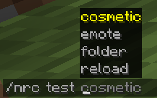
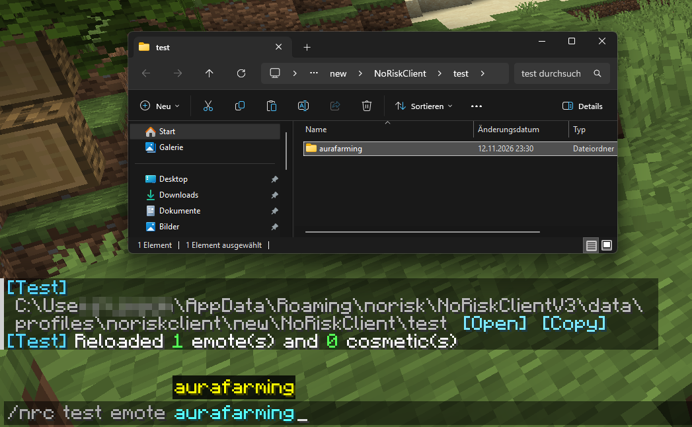

# 12. Ingame-Test

← [Test-Setup](11-Test-Setup) · **12 / 15** · [Cosmetic-Typen →](13-Cosmetic-Typen)

---

Je nachdem, welchen Weg du in [11. Test-Setup](11-Test-Setup) gewählt hast:

- **[A — Test-Ordner](#a--test-ordner)** → für alle, keine Rechte nötig
- **[B — Designer-Ordner](#b--designer-ordner)** → mit Designer-Rechten, inklusive Shop-Ansicht

---

## A — Test-Ordner

### Commands

| Command | Was passiert |
|---------|--------------|
| `/nrc test` | Zeigt, was im Test-Ordner erkannt wurde — Emotes, Cosmetics und übersprungene Files mit Grund |
| `/nrc test folder` | Zeigt den Pfad zum Test-Ordner mit **[Open]** (öffnen) und **[Copy]** (Pfad kopieren) |
| `/nrc test reload` | Lädt den Ordner von Hand neu |
| `/nrc test emote <name>` | Spielt ein Emote aus dem Test-Ordner ab — nochmal ausführen stoppt es |
| `/nrc test cosmetic <name>` | Zieht ein Cosmetic aus dem Test-Ordner an — nochmal ausführen zieht es aus |

`<name>` ist der Dateiname ohne Endung bzw. der Ordnername. **Tab** schlägt dir alle gefundenen Emotes und Cosmetics vor.



### Beispiel

Ordner öffnen, Export reinziehen, der Client meldet **„Reloaded 1 emote(s)“** — dann abspielen:



### Automatisch neu laden

Der Client beobachtet den Test-Ordner. Sobald du eine Datei speicherst oder neu reinlegst, lädt er sie nach kurzer Pause neu und meldet im Chat **„[Test] Reloaded …“**. Du kannst also in Blockbench exportieren und direkt ingame weitertesten.

Liegt beim Betreten eines Servers etwas im Test-Ordner, erinnert dich der Client im Chat daran.

### Übersprungene Files

Passt ein Name nicht (z.B. Großbuchstaben oder Leerzeichen), bekommst du einen Hinweis mit dem Grund und einem Namensvorschlag, z.B.:

```
Mein Emote  →  only a-z 0-9 . _ - allowed (try 'mein_emote')
```

> 👀 Alles aus dem Test-Ordner siehst **nur du**. Andere Spieler bekommen davon nichts mit.

---

## B — Designer-Ordner

Mit Designer-Rechten schaltest du den Designer-Ordner so ein:

```
/nrc designer source toggle
```


### Im Shop sehen

Wenn du alles richtig gemacht hast, sollten jetzt deine Cosmetics und Emotes **im Shop** angezeigt werden:


### Cosmetics lokal ausrüsten

Du kannst Cosmetics **lokal** testen — also ausrüsten, ohne sie wirklich zu besitzen:

```
/nrc cosmetics designer toggle <name>
```


### Emotes abspielen

```
/nrc emote play <name>
```


> 💡 **Neue Dateien hinzugefügt?** Im Designer-Ordner werden neue Files erst nach einem Rescan gefunden:
>
> ```
> /nrc designer source rescan
> ```
>
> Geänderte, schon vorhandene Files werden direkt neu gelesen.

### Alle Designer-Commands

| Command | Was passiert |
|---------|--------------|
| `/nrc designer source toggle` | Designer-Ordner an/aus |
| `/nrc designer source on` / `off` | Designer-Ordner gezielt an/aus |
| `/nrc designer source status` | Zeigt, ob der Designer-Ordner gerade aktiv ist |
| `/nrc designer source rescan` | Liest den Ordner neu ein (neue Files) |
| `/nrc cosmetics designer toggle <name>` | Cosmetic lokal an-/ausziehen |
| `/nrc cosmetics designer togglebundle <name>` | Ganzes Bundle lokal an-/ausziehen |
| `/nrc cosmetics designer offset X\|Y\|Z <wert> <name>` | Cosmetic live verschieben, um die richtige Position zu finden |
| `/nrc cosmetics designer mirror <modus> <name>` | Render-Modus testen (`ORIGINAL`, `MIRROR`, `BOTH`) |
| `/nrc cosmetics designer customSkin [clear] <input> <name>` | Eigene Textur auf das Cosmetic legen |
| `/nrc cosmetics designer toggleModel` | Zwischen breitem und schmalem Skin-Modell wechseln |
| `/nrc emote play <name>` | Emote abspielen |
| `/nrc emote stop` | Emote stoppen |
| `/nrc emote list` | Alle Emotes auflisten |
| `/nrc emote sound list` / `play` | Sounds auflisten / abspielen |

> 👀 Alles, was du mit `/nrc cosmetics designer` anziehst, siehst **nur du**.

---

## Geht nicht?

| Problem | Lösung |
|---------|--------|
| Test-Ordner: Emote wird nicht gefunden | `/nrc test` — zeigt, was erkannt und was übersprungen wurde |
| Test-Ordner: Änderung kommt nicht an | `/nrc test reload` |
| *„could not be played. Is the animation JSON valid?“* | Animation-Datei kaputt — neu aus Blockbench exportieren |
| Designer-Ordner: neue Datei taucht nicht auf | `/nrc designer source rescan` |
| `toggle <name>` sagt *Unknown cosmetic* | Einmal den Wardrobe öffnen, dann den Command nochmal ausführen |
| Nach einem Rescan ist dein Outfit unsichtbar | Das Test-Cosmetic einmal aus- und wieder anziehen |
| Cosmetic taucht gar nicht auf | Im Log (`logs/latest.log`) nach deinem Dateinamen suchen — fehlende/doppelte `id` oder kaputtes JSON stehen nur dort |
| Cosmetic-Cubes ingame unsichtbar | Cubes liegen nicht in einem `armor…`-Ordner → [2. Aufbau](02-Aufbau) |
| Auf Windows geht's, auf Mac/Linux fehlt die Textur | Dateiname hat Großbuchstaben — alles klein schreiben |
| Particle erscheint am falschen Spieler | Particle immer an einen **Locator** hängen → [8. Particle](08-Particle#3-locator-wählen) |
| Particle/Sound fehlt bei Loop-Emotes am Anfang | Keyframe nicht genau auf `0` oder auf das Ende legen |
| Von mehreren Particles auf einem Keyframe kommt nur eins | Keyframes leicht versetzen |
| UI sieht im Designer-Modus kaputt aus | Den kompletten `nrc-cosmetics`-Ordner im Designer-Ordner lassen |

---

## Fertig! 🎉

**Viel Spaß beim Testen :3**

Weiter geht's mit den Nachschlage-Kapiteln: [Cosmetic-Typen](13-Cosmetic-Typen) · [Referenz](14-Referenz) · [Blockbench-Plugin](15-Blockbench-Plugin)

— Tinus aka. p2pe ❤️

---

← [Test-Setup](11-Test-Setup) · **12 / 15** · [Cosmetic-Typen →](13-Cosmetic-Typen)
