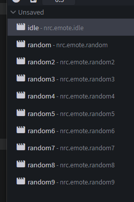

# 14. Referenz

← [Cosmetic-Typen](13-Cosmetic-Typen) · **14 / 15** · [Blockbench-Plugin →](15-Blockbench-Plugin)

---

Zum Nachschlagen: alle Felder der `.norisk.json`, die Extra-Einstellungen in der `.animation.json` und Knochen mit Sonderbedeutung.

> ✏️ = setzt das [Blockbench-Plugin](15-Blockbench-Plugin) beim Export für dich. Alles andere trägst du von Hand ein.

---

## `.norisk.json` — gemeinsame Felder

| Feld | Typ | Beschreibung |
|------|-----|--------------|
| `id` ✏️ | UUID | Eindeutige ID. **Nie doppelt** vergeben. |
| `name` ✏️ | Text | Anzeigename im Shop |
| `creator` ✏️ | Text | Dein Name |
| `price` ✏️ | Zahl | Preis in Coins |
| `rarity` ✏️ | Text | `COMMON`, `UNCOMMON`, `RARE`, `EPIC`, `LEGENDARY`, `UNOBTAINABLE` (letzteres nur von Hand) |
| `dateAdded` ✏️ | Datum | `JJJJ-MM-TT` |
| `isExclusive` ✏️ | true/false | Exklusives Item |
| `overflow` | Objekt | Shop-Layout, z.B. `{ "overflowInShop": true }` |

## `.norisk.json` — Emotes

| Feld | Typ | Beschreibung |
|------|-----|--------------|
| `emoteFile` | Pfad | Pfad zur Animation, relativ zum `emotes`-Ordner, z.B. `dripstone/dripstone.animation.json` |
| `category` | Text | Gruppe im Emote-Menü: `SPECIAL`, `RANDOM`, `CLASSIC`, `FUNNY`, `DANCE` |
| `multiEmote` | true/false | Emote mit zwei Spielern → [Interaktive Emotes](#interaktive-emotes) |

## `.norisk.json` — Cosmetics

| Feld | Typ | Beschreibung |
|------|-----|--------------|
| `type` ✏️ | Text | Typ des Cosmetics → [13. Cosmetic-Typen](13-Cosmetic-Typen) |
| `path` ✏️ | Text | Ordnername des Cosmetics |
| `supportedBones` ✏️ | Liste | `armor`-Knochen, in denen Cubes liegen — das Plugin trägt sie automatisch ein |
| `defaultSettings` ✏️ | Objekt | Größe, Position, Vorschau → [unten](#defaultsettings) |
| `features` ✏️ | Liste | Regler für Spieler → [unten](#features--regler) |
| `layers` ✏️ | Liste | `GLOW`, `COLOR`, `COLOR_AND_GLOW` → [Glow](04-Texture#glow-leuchtende-pixel) / [Color Change](04-Texture#color-change-farbe-wechseln) |
| `compatibleCosmetics` ✏️ | Liste von IDs | Cosmetics, die zusammen getragen werden dürfen |
| `blacklistCosmetics` | Liste von IDs | Cosmetics, die **nicht** zusammen getragen werden dürfen |
| `multiTexture` | true/false | Textur-Varianten aus dem Unterordner `textures/` anbieten → [Mehrere Texturen](04-Texture#mehrere-texturen-multitexture) |
| `variant` | Objekt | Variante eines anderen Cosmetics: `{ "parentId": "<UUID>" }` |
| `shouldReplaceHelmet` | true/false | Nur `HAT`: Helm ausblenden (Standard: an) |
| `hasElytraTexture` | true/false | Nur `CAPE`: Textur auch auf der Elytra |
| `disabledBodyParts` | Liste | Skin-Ebenen ausblenden: `HAT`, `JACKET`, `LEFT_SLEEVE`, `RIGHT_SLEEVE`, `LEFT_PANTS_LEG`, `RIGHT_PANTS_LEG`, `CAPE` |
| `firstPersonArmEnabled` | true/false | Cosmetic am Arm auch in der Ego-Perspektive zeigen |
| `firstPersonArmOffset` | x/y/z | Position dafür |
| `customTextureEnabled` | true/false | Spieler dürfen eine eigene Textur draufladen |
| `animationSettings` | Objekt | Quirks → [unten](#quirks-animationsettings) |

### `defaultSettings`

| Feld | Beschreibung |
|------|--------------|
| `scale` | Größe am Spieler (Standard `1.0`) |
| `offset` | Verschiebung am Spieler, `{ "x": 0, "y": 0, "z": 0 }` |
| `previewScale` | Größe in der Shop-Vorschau |
| `previewOffset` | Verschiebung in der Shop-Vorschau |
| `renderMode` | `ORIGINAL`, `MIRROR` (gespiegelt) oder `BOTH` (beides) |
| `color` | Standardfarbe: `{ "red": 1, "green": 1, "blue": 1, "alpha": 1, "chroma": false }` oder `null` |

> 💡 Die passenden Werte für `offset` und `renderMode` findest du ingame mit `/nrc cosmetics designer offset …` und `… mirror …` → [12. Ingame-Test](12-Ingame-Test#alle-designer-commands).

### `features` — Regler

Mit `features` stellen Spieler im Wardrobe per Regler Größe oder Position selbst ein. Jeder Eintrag hat einen `type` und einen `range` (kleinster/größter Wert des Reglers).

| `type` | Regler für |
|--------|------------|
| `SCALABLE` | Größe |
| `X_AXIS` | Position links/rechts |
| `Y_AXIS` | Position hoch/runter |

> 🚧 *Beispiel-JSON für `range` folgt.*

### Quirks (`animationSettings`)

Steuert, wie oft die Quirk-Animationen (`nrc.quirk_1` … `nrc.quirk_4`, siehe [5. Animation](05-Animation#animationsnamen-für-cosmetics)) abgespielt werden.

| Feld | Beschreibung |
|------|--------------|
| `probability` | Wahrscheinlichkeit, dass ein Quirk kommt |
| `timeRange` | Zeitspanne zwischen zwei Quirks |

> 🚧 *Beispiel-JSON folgt.*

---

## Extra-Einstellungen in der `.animation.json` (Emotes)

Diese Felder stehen **pro Animation** in der `.animation.json`. Im Plugin stellst du sie per Schalter ein (**Animation → Edit NoRisk Client Emote Settings** oder im [Export-Dialog](10-Export)).

| Feld | Plugin-Schalter | Standard | Wirkung |
|------|-----------------|----------|---------|
| `disableOnMove` | Disable on move | aus | Emote bricht ab, sobald der Spieler sich bewegt |
| `disableOnHit` | Disable on hit | **an** | Emote bricht ab, wenn der Spieler **zuschlägt** |
| `firstPerson` | First person | aus | Emote ist auch in der Ego-Perspektive sichtbar |
| `stayInFirstPerson` | Stay in first person | aus | Spieler bleibt während des Emotes in der Ego-Perspektive |
| `immersiveCamera` | Immersive camera | aus | Kamera folgt in der Ego-Perspektive dem Kopf-Knochen |
| `lockVanillaBones` | Lock vanilla bones | – | Pro Knochen: `true` = Knochen bleibt in Vanilla-Pose, das Emote bewegt ihn nicht |

Beispiel:

```json
{
  "format_version": "1.8.0",
  "animations": {
    "meinemote": {
      "loop": true,
      "animation_length": 2.0,
      "bones": { "...": "..." },
      "disableOnMove": true,
      "disableOnHit": true,
      "firstPerson": false,
      "stayInFirstPerson": false,
      "immersiveCamera": false,
      "lockVanillaBones": {
        "bipedRig": false,
        "bipedHead": true,
        "bipedBody": false,
        "bipedRightArm": false,
        "bipedLeftArm": false,
        "bipedRightLeg": false,
        "bipedLeftLeg": false
      }
    }
  }
}
```

Den Loop-Modus (`loop`) nimmt das Plugin direkt aus Blockbench (Play Once / Loop / Hold On Last Frame).

---

## Spezielle Knochen

| Knochen | Bedeutung |
|---------|-----------|
| `bipedRig` | Wurzel des Spielers — bewegt den ganzen Körper |
| `bipedHead`, `bipedBody`, `bipedRightArm`, `bipedLeftArm`, `bipedRightLeg`, `bipedLeftLeg` | Vanilla-Körperteile. **Eigene Cubes nie direkt hier rein** — sie wären unsichtbar. |
| `armorHead`, `armorBody`, `armorRightArm`, `armorLeftArm`, `armorRightLeg`, `armorLeftLeg` | Hier kommen deine Cubes rein → [2. Aufbau](02-Aufbau) |
| `armorRightBoot`, `armorLeftBoot` | Füße, z.B. für `SHOES` |
| `armorRightArmSlim`, `armorLeftArmSlim` | Arme bei schmalen Skins (Alex) |
| `armorBuddy` | Alle Cubes eines [Buddys](13-Cosmetic-Typen#buddys) — nicht im Plugin-Rig, selbst anlegen |

| `rig2` (Kopie des Rigs) | Mitspieler bei [interaktiven Emotes](#interaktive-emotes) |

> 🚧 **Platzhalter:** weitere Knochen mit Sonderbedeutung (z.B. Gegenstand in der Hand) werden noch ergänzt.

---

## Interaktive Emotes

Interaktive Emotes (Multi-Emotes) spielen **zwei Spieler zusammen** — z.B. Handschlag oder Umarmung. In der `.norisk.json` steht dafür `"multiEmote": true`.

### Aufbau

1. **Rig duplizieren:** Das komplette Spieler-Rig im Emote kopieren — das zweite Rig ist der Mitspieler (`rig2`).
2. Animationen nach diesem Schema anlegen:

| Animation | Wann | Inhalt |
|-----------|------|--------|
| `nrc.emote.idle` | Der Spieler startet das Emote und **wartet** auf einen Mitspieler | Nur der erste Spieler bewegt sich. **`rig2` auf Scale `0`** setzen, damit er nicht zu sehen ist. |
| `nrc.emote.interaction` | Ein Mitspieler macht mit | **Beide Rigs** sind zu sehen und spielen die gemeinsame Animation. |
| `nrc.emote.random`, `nrc.emote.random2` … | statt `interaction` | Mehrere Varianten — bei jeder Interaktion wird **zufällig eine** davon genommen. |

Du brauchst also **entweder** `nrc.emote.interaction` **oder** beliebig viele `nrc.emote.random…`.



> ⚠️ Das Blockbench-Plugin hat für Multi-Emotes keine eigene Vorlage — Rig duplizieren und `multiEmote` in der `.norisk.json` setzt du von Hand.

---

← [Cosmetic-Typen](13-Cosmetic-Typen) · **14 / 15** · [Blockbench-Plugin →](15-Blockbench-Plugin)
